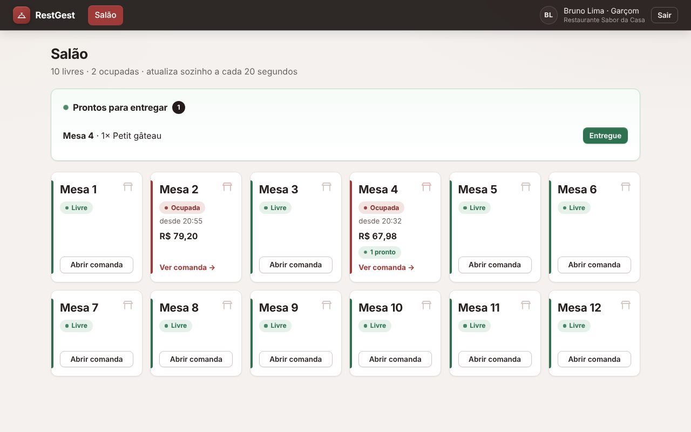
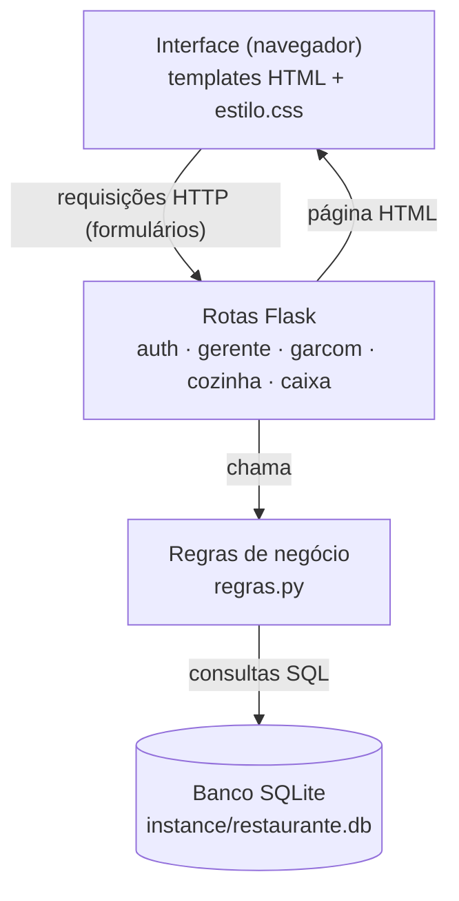

# RestGest: gestão de pedidos para restaurantes

Sistema web (SaaS) para restaurantes pequenos e médios controlarem o salão, a cozinha e o caixa. O garçom abre a comanda da mesa e lança os itens, a cozinha vê a fila por ordem de chegada, o caixa fecha a conta e o gerente acompanha as vendas do dia. Cada restaurante assina um plano mensal e usa o sistema pelo navegador, sem instalar nada, com os seus dados separados dos de outros clientes.

Este repositório é o MVP (versão inicial) apresentado na disciplina.

Repositório: https://github.com/Gmorguetto/restgest



## Integrantes

- Gabriel Paulino Morguetto
- João Victor Pinheiro Comoti
- Pedro Reis Amaral Mello
- Pedro Rodrigues Barros

## Problema e público-alvo

Muitos restaurantes ainda usam comanda de papel. Pedidos se perdem ou chegam trocados à cozinha, o fechamento da conta é lento e o dono não sabe quanto vendeu no dia.

| Quem usa | O que faz no sistema |
| --- | --- |
| Gerente ou dono | Cadastra cardápio, mesas e equipe, escolhe o plano e acompanha o painel do dia |
| Garçom | Abre a comanda da mesa, lança itens com observação e entrega o que ficou pronto |
| Cozinha | Vê a fila de itens por ordem de chegada e marca "em preparo" e "pronto" |
| Caixa | Fecha a conta em dinheiro (com troco), cartão ou Pix, inclusive conta dividida, com ou sem os 10% |

## Funcionalidades

- Cadastro de restaurante com 14 dias de teste grátis (onboarding do SaaS)
- Login com quatro perfis; cada perfil só acessa as suas telas
- Cardápio organizado por categoria, com busca por nome, filtro por categoria ou por produtos indisponíveis, interruptor de disponibilidade na própria linha e janela para editar nome, categoria e preço
- Mesas e equipe, com limite conforme o plano contratado
- Comanda por mesa, com observação por item e cancelamento antes do preparo
- Cozinha em quadro de comandas (Novos, Em preparo, Prontos): os itens de cada mesa ficam juntos, com observação em destaque, cor pelo tempo de espera (verde, amarelo, vermelho), botão para avançar a comanda inteira de uma vez, relógio e modo tela cheia para a TV da cozinha
- Itens prontos aparecem para o garçom no salão
- Fechamento de conta só depois da entrega, com troco e conta dividida
- Taxa de serviço (10%) somada à conta; o caixa pode retirar, porque é opcional para o cliente, e o gerente define o percentual em Ajustes
- Painel do dia: valor recebido em destaque, contas fechadas, ticket médio, taxa de serviço, gráfico de vendas por hora (com valores ao passar o mouse e versão em tabela), ocupação das mesas, situação da cozinha, avisos do que precisa de atenção (pedido atrasado, item pronto esperando, mesa pronta para fechar), formas de pagamento, produtos mais vendidos e vendas por garçom, com o garçom que mais vendeu em destaque e a taxa de serviço de cada um. A página se atualiza sozinha a cada minuto
- Troca de plano (cobrança simulada nesta versão)
- Telas que funcionam no celular do garçom
- Interface com ilustrações próprias em SVG (página inicial, login e telas vazias), figura para cada categoria do cardápio, transição suave entre páginas, números do painel que contam até o valor e destaque "Chegou agora" para comanda nova na cozinha; as animações são desligadas quando o computador pede menos movimento

## Tecnologias

| Tecnologia | Para quê |
| --- | --- |
| Python 3.10+ | Linguagem do sistema |
| Flask 3 | Servidor web: rotas, sessão de login, templates |
| Jinja2 | Páginas HTML geradas no servidor |
| HTML, CSS e JavaScript | Interface com paleta própria e animações, sem framework de front-end |
| SQLite | Banco de dados em um arquivo, sem instalar servidor |
| Werkzeug | Hash das senhas (scrypt) |
| python-dotenv | Lê os segredos do arquivo `.env` |
| pytest | Testes automáticos |

## Como executar

### Atalho no Windows

Com o Python 3.10 ou mais recente instalado, dê dois cliques em `rodar.bat`. Na primeira vez ele cria o ambiente virtual, instala as dependências, gera o `.env` com uma chave e uma senha de demonstração aleatórias (a senha aparece na janela) e cria o banco de demonstração. Depois ele inicia o sistema e abre <http://127.0.0.1:5000> no navegador.

Os dados de demonstração têm vendas e mesas do dia em que o banco foi criado, e o painel mostra só o dia atual. No dia da apresentação, dê dois cliques em `recriar-demo.bat` para recriar a demonstração com a data de hoje. Ele pede confirmação, porque apaga o que foi cadastrado no banco local.

### Passo a passo (qualquer sistema)

Pré-requisitos: [Python 3.10 ou mais recente](https://www.python.org/downloads/) e Git. Confira com `python --version` (no Linux e no macOS, `python3 --version`).

1. Baixe o projeto e entre na pasta:

   ```bash
   git clone https://github.com/Gmorguetto/restgest.git
   cd restgest
   ```

2. Crie e ative um ambiente virtual:

   ```bash
   # Windows
   python -m venv .venv
   .venv\Scripts\activate

   # Linux ou macOS
   python3 -m venv .venv
   source .venv/bin/activate
   ```

3. Instale as dependências:

   ```bash
   pip install -r requirements.txt
   ```

4. Crie o arquivo `.env` a partir do modelo e troque os dois valores:

   ```bash
   # Windows
   copy .env.example .env
   # Linux ou macOS
   cp .env.example .env
   ```

   - `SECRET_KEY`: gere com `python -c "import secrets; print(secrets.token_hex(32))"`
   - `SENHA_DEMO`: senha dos usuários de demonstração (mínimo 6 caracteres)

5. Crie o banco com os dados de demonstração:

   ```bash
   flask seed-demo
   ```

   Rode de novo no dia da apresentação, para as vendas de demonstração serem do dia. Para começar com o banco vazio, use `flask init-db` e cadastre um restaurante em "Teste grátis".

6. Rode o sistema e abra <http://127.0.0.1:5000> no navegador:

   ```bash
   flask run
   ```

### Usuários de demonstração

Todos usam a senha definida em `SENHA_DEMO`. Na tela de login, um clique no perfil preenche o e-mail.

| Restaurante | Gerente | Garçom | Cozinha | Caixa |
| --- | --- | --- | --- | --- |
| Restaurante Sabor da Casa (plano Profissional) | gerente@sabordacasa.demo | garcom@sabordacasa.demo (Bruno) e julia@sabordacasa.demo (Júlia) | cozinha@sabordacasa.demo | caixa@sabordacasa.demo |
| Lanchonete do Bairro (plano Básico) | gerente@lanchonetedobairro.demo | garcom@lanchonetedobairro.demo | cozinha@lanchonetedobairro.demo | (sem caixa; o gerente faz) |

O Sabor da Casa cobra 10% de serviço e já começa com três contas pagas hoje (duas do Bruno e uma da Júlia) e duas mesas em atendimento, para o painel e a cozinha não ficarem vazios. A Lanchonete não cobra taxa de serviço e existe para mostrar que um restaurante não vê os dados do outro.

### Testes automáticos

```bash
pytest
```

Os 89 testes cobrem o fluxo completo pelas telas, as regras de negócio, as permissões de cada perfil e a separação entre restaurantes.

## Roteiro da demonstração

Abra uma janela normal e uma janela anônima, para ficar logado com dois perfis ao mesmo tempo.

1. Gerente (`gerente@sabordacasa.demo`) mostra o painel e o cardápio.
2. Garçom (`garcom@sabordacasa.demo`) abre a mesa 5 e lança 1 feijoada, 2 sucos "sem açúcar" e 1 pudim.
3. Cozinha (`cozinha@sabordacasa.demo`) vê a comanda da mesa 5 chegar em "Novos", com o "sem açúcar" em destaque, clica em "Iniciar preparo de tudo" e depois em "Tudo pronto".
4. Garçom vê os itens em "Prontos para entregar" e marca "Entregue".
5. Caixa (`caixa@sabordacasa.demo`) mostra o consumo mais os 10% de serviço e fecha a conta da mesa 5 por Pix; a mesa volta a ficar livre.
6. Gerente abre o painel e mostra a venda somada ao dia, a nova coluna no gráfico de vendas por hora e o garçom que mais vendeu, com a taxa de serviço de cada garçom.

## Como o sistema está organizado

O sistema tem três camadas. O navegador só conversa com a aplicação Flask, por requisições HTTP; só a aplicação acessa o banco.



| Camada | Arquivos | Responsabilidade |
| --- | --- | --- |
| Interface | `restaurante/templates/`, `restaurante/static/` (`estilo.css`, `app.js`) | Uma tela por perfil, gerada no servidor, com animações leves no navegador |
| Lógica: rotas | `auth.py`, `gerente.py`, `garcom.py`, `cozinha.py`, `caixa.py` | Recebem o formulário, conferem login e perfil, chamam as regras, devolvem a página |
| Lógica: regras | `regras.py`, `util.py` | Regras do restaurante e do SaaS; não conhecem HTTP, por isso os testes as usam direto |
| Dados | `db.py`, `schema.sql` | Conexão e estrutura das 8 tabelas |
| Apoio | `dados_demo.py`, `tests/` | Dados de demonstração e testes automáticos |

### Modelo de dados

| Tabela | O que guarda |
| --- | --- |
| `restaurante` | Cada cliente do SaaS: nome, plano, fim do teste grátis, % de taxa de serviço |
| `usuario` | Pessoas da equipe, com perfil e hash da senha |
| `categoria`, `produto` | Cardápio; preço em centavos |
| `mesa` | Mesas do salão, livres ou ocupadas |
| `pedido` | A comanda de uma mesa: aberta, fechada ou cancelada, com o % de serviço aplicado |
| `item_pedido` | Itens da comanda, com o preço do momento da venda e o status na cozinha |
| `pagamento` | Pagamentos da conta (pode haver vários: conta dividida) |

## Técnicas utilizadas

| Técnica | Onde está |
| --- | --- |
| Arquitetura em camadas (interface, lógica, dados) | Pastas e arquivos descritos acima |
| Banco relacional com chaves estrangeiras e restrições (`CHECK`, `UNIQUE`) | `schema.sql` |
| Multi-inquilino (vários clientes no mesmo sistema) | `restaurante_id` em todas as consultas de `regras.py` |
| Autenticação com senha guardada como hash | `regras.autenticar`, `_inserir_usuario` |
| Controle de acesso por perfil | decorador `perfil_requerido` em `auth.py` |
| Sessão de login assinada com chave secreta | `SECRET_KEY` no `.env` |
| Proteção contra CSRF em todo formulário | `_verificar_csrf` em `__init__.py`, macro `csrf()` |
| SQL parametrizado contra SQL injection | todos os `db.execute(..., (parâmetros))` |
| Transações (tudo ou nada) | blocos `with db:` em `regras.py` |
| Concorrência: dois garçons na mesma mesa | índice único `um_pedido_aberto_por_mesa` em `schema.sql` |
| Concorrência: dois cliques no mesmo item | `UPDATE ... WHERE status = ?` em `regras.avancar_item` |
| Dinheiro em centavos (sem erro de arredondamento) | `util.py`, colunas `*_centavos`, `regras.valor_da_taxa` |
| Migração de banco sem perder dados (colunas novas em bancos antigos) | `db.atualizar_banco`, chamada ao iniciar |
| Padrão POST, redirecionamento, GET (sem reenvio ao recarregar) | todas as rotas de formulário |
| Configuração por variáveis de ambiente | `.env.example`, `.flaskenv` |
| Interface responsiva | `@media` no fim de `estilo.css` |
| Animações e bloqueio de envio duplo (onda no clique, botão "enviando") | `static/app.js`, `@keyframes` em `estilo.css` |
| Respeito à preferência de menos movimento do sistema | `prefers-reduced-motion` em `estilo.css` |
| Testes automáticos de regras e de fluxo | `tests/test_regras.py`, `tests/test_fluxo.py` |

## Segurança e dados sensíveis

- Nenhuma senha, chave ou credencial está no código. `SECRET_KEY` e `SENHA_DEMO` ficam no `.env`, que está no `.gitignore`; o repositório leva só o `.env.example`.
- Senhas são guardadas como hash (scrypt), nunca em texto puro.
- Os testes sorteiam uma senha nova a cada execução.

## Modelo de negócio e preço

Assinatura mensal por restaurante. O dono se cadastra no site, testa por 14 dias e escolhe um plano. Os preços seguem o método da apostila *Do problema do cliente ao orçamento de um sistema*: custo por hora, horas de trabalho, despesas, reserva, tributos e lucro, com o markup do Sebrae. A memória de cálculo completa, o escopo com “como conferir”, o que fica fora, as condições e uma proposta modelo estão em [`docs/precificacao.md`](docs/precificacao.md); `python docs/precificacao.py` refaz as contas e confere se batem com o sistema.

| Plano | Para quem | Limites | Suporte | Preço |
| --- | --- | --- | --- | --- |
| Teste grátis | Quem acabou de se cadastrar | 14 dias, 10 mesas, 4 usuários | Resposta em até 1 dia útil | R$ 0 |
| Básico | Lanchonetes e bares pequenos | 10 mesas, 4 usuários (um por perfil) | 30 min/mês, resposta em até 1 dia útil | R$ 79/mês |
| Profissional | Restaurantes de médio porte | 40 mesas, 10 usuários | 1 h/mês, resposta em até 4 horas úteis | R$ 119/mês |
| Implantação assistida (opcional) | Quem quer começar com tudo pronto | Cadastro, orientação e primeiro turno (8 h) | Prazo de 5 dias úteis | R$ 600, uma vez |

- A mensalidade inclui hospedagem, backup, atualizações e correções de erro. Função nova é orçada à parte.
- A assinatura dá acesso ao sistema pela internet; o código-fonte não está incluído.
- Fora desta versão: aplicativo nativo, QR code, iFood e WhatsApp, nota fiscal, impressora e maquininha integradas, estoque e várias unidades.
- Os valores de entrada são hipóteses do grupo. Nesta versão a troca de plano é simulada e nenhuma cobrança é feita.

## Uso de inteligência artificial

O registro de quais ferramentas foram usadas, em quais etapas e com quais resultados está em [`docs/uso-de-ia.md`](docs/uso-de-ia.md).

## Limitações e próximos passos

- Estoque de insumos com baixa automática e alerta de mínimo
- Relatórios por período (semana, mês)
- Atualização em tempo real (WebSocket) em vez de recarregar a página a cada 15 a 30 segundos
- Cobrança real por gateway de pagamento e emissão de nota fiscal
- Publicação na internet com PostgreSQL no lugar do SQLite
- QR code na mesa para o cliente ver o cardápio
